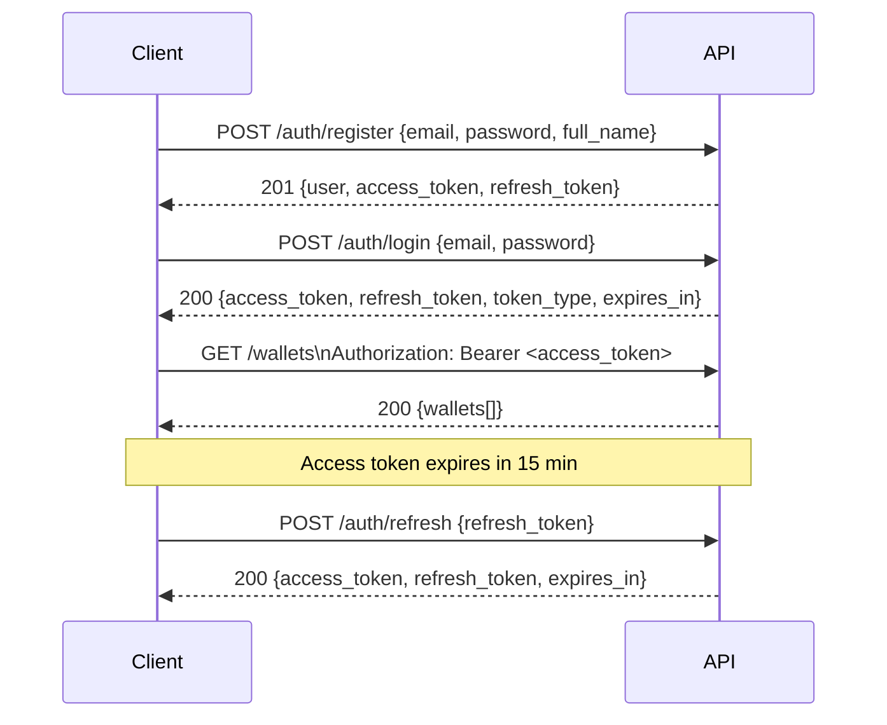

# FinLedger API Documentation (OpenAPI 3.1)

## Base Information
- **Base URL**: `https://api.finledger.io/v1`
- **Version**: 1.0.0
- **Authentication**: Bearer Token (JWT)
- **Content-Type**: `application/json`
- **Idempotency**: Required for all mutations via `Idempotency-Key` header

## Authentication Flow



## Endpoints

### Authentication

#### Register User
```http
POST /auth/register
Content-Type: application/json

{
  "email": "user@example.com",
  "password": "SecurePass123!",
  "full_name": "John Doe"
}
```

**Response 201:**
```json
{
  "user": {
    "id": "uuid",
    "email": "user@example.com",
    "full_name": "John Doe",
    "role": "USER",
    "is_active": true,
    "is_verified": false,
    "created_at": "2024-01-15T10:30:00Z"
  },
  "access_token": "eyJhbGciOiJIUzI1NiIs...",
  "refresh_token": "eyJhbGciOiJIUzI1NiIs...",
  "token_type": "bearer",
  "expires_in": 900
}
```

#### Login
```http
POST /auth/login
Content-Type: application/json

{
  "email": "user@example.com",
  "password": "SecurePass123!"
}
```

**Response 200:** Same as register

#### Refresh Token
```http
POST /auth/refresh
Content-Type: application/json

{
  "refresh_token": "eyJhbGciOiJIUzI1NiIs..."
}
```

**Response 200:** New access_token + refresh_token

#### Logout (Revoke Refresh Token)
```http
POST /auth/logout
Authorization: Bearer <access_token>
Content-Type: application/json

{
  "refresh_token": "eyJhbGciOiJIUzI1NiIs..."
}
```

**Response 204:** No content

#### Get Current User
```http
GET /auth/me
Authorization: Bearer <access_token>
```

**Response 200:**
```json
{
  "id": "uuid",
  "email": "user@example.com",
  "full_name": "John Doe",
  "role": "USER",
  "is_active": true,
  "is_verified": true,
  "last_login_at": "2024-01-15T10:30:00Z",
  "created_at": "2024-01-10T08:00:00Z"
}
```

---

### Wallets

#### Create Wallet
```http
POST /wallets
Authorization: Bearer <access_token>
Content-Type: application/json

{
  "currency": "USD",
  "name": "Primary Wallet"
}
```

**Response 201:**
```json
{
  "id": "uuid",
  "user_id": "uuid",
  "currency": "USD",
  "name": "Primary Wallet",
  "status": "ACTIVE",
  "created_at": "2024-01-15T10:30:00Z"
}
```

#### List Wallets
```http
GET /wallets?currency=USD&status=ACTIVE&limit=20&offset=0
Authorization: Bearer <access_token>
```

**Response 200:**
```json
{
  "items": [
    {
      "id": "uuid",
      "user_id": "uuid",
      "currency": "USD",
      "name": "Primary Wallet",
      "status": "ACTIVE",
      "created_at": "2024-01-15T10:30:00Z"
    }
  ],
  "total": 1,
  "limit": 20,
  "offset": 0
}
```

#### Get Wallet
```http
GET /wallets/{wallet_id}
Authorization: Bearer <access_token>
```

**Response 200:** Wallet object

#### Get Wallet Balance
```http
GET /wallets/{wallet_id}/balance
Authorization: Bearer <access_token>
```

**Response 200:**
```json
{
  "wallet_id": "uuid",
  "currency": "USD",
  "posted_balance": "1000.00",
  "pending_balance": "1100.00",
  "available_balance": "950.00",
  "as_of": "2024-01-15T10:30:00Z"
}
```

#### Deposit
```http
POST /wallets/{wallet_id}/deposit
Authorization: Bearer <access_token>
Idempotency-Key: unique-key-123
Content-Type: application/json

{
  "amount": "100.00",
  "description": "Salary deposit",
  "metadata": {"source": "employer_payroll"}
}
```

**Response 201:**
```json
{
  "transaction_id": "uuid",
  "status": "COMPLETED",
  "amount": "100.00",
  "currency": "USD",
  "type": "DEPOSIT",
  "description": "Salary deposit",
  "posted_balance": "1100.00",
  "available_balance": "1050.00",
  "created_at": "2024-01-15T10:30:00Z",
  "completed_at": "2024-01-15T10:30:00Z"
}
```

#### Withdraw
```http
POST /wallets/{wallet_id}/withdraw
Authorization: Bearer <access_token>
Idempotency-Key: unique-key-456
Content-Type: application/json

{
  "amount": "50.00",
  "description": "ATM withdrawal",
  "metadata": {"atm_id": "ATM_12345"}
}
```

**Response 201:** Similar to deposit

#### Transfer
```http
POST /wallets/{wallet_id}/transfer
Authorization: Bearer <access_token>
Idempotency-Key: unique-key-789
Content-Type: application/json

{
  "amount": "25.00",
  "destination_wallet_id": "uuid-of-dest-wallet",
  "description": "Payment to friend",
  "metadata": {"category": "personal"}
}
```

**Response 201:**
```json
{
  "transaction_id": "uuid",
  "status": "COMPLETED",
  "amount": "25.00",
  "currency": "USD",
  "type": "TRANSFER_OUT",
  "description": "Payment to friend",
  "source_wallet_id": "uuid",
  "destination_wallet_id": "uuid",
  "posted_balance": "1025.00",
  "available_balance": "1000.00",
  "fraud_risk_score": "0.150",
  "fraud_risk_level": "LOW",
  "created_at": "2024-01-15T10:30:00Z",
  "completed_at": "2024-01-15T10:30:00Z"
}
```

#### Get Wallet Transactions
```http
GET /wallets/{wallet_id}/transactions?type=TRANSFER_OUT&status=COMPLETED&limit=20&offset=0&start_date=2024-01-01&end_date=2024-01-31
Authorization: Bearer <access_token>
```

**Response 200:**
```json
{
  "items": [
    {
      "id": "uuid",
      "type": "TRANSFER_OUT",
      "status": "COMPLETED",
      "amount": "25.00",
      "currency": "USD",
      "description": "Payment to friend",
      "counterparty_wallet_id": "uuid",
      "counterparty_name": "Jane Smith",
      "fraud_risk_score": "0.150",
      "fraud_risk_level": "LOW",
      "created_at": "2024-01-15T10:30:00Z",
      "completed_at": "2024-01-15T10:30:00Z"
    }
  ],
  "total": 42,
  "limit": 20,
  "offset": 0
}
```

---

### Ledger

#### Get Ledger Accounts (Chart of Accounts)
```http
GET /ledger/accounts?type=ASSET&active_only=true
Authorization: Bearer <access_token>
```

**Response 200:**
```json
{
  "items": [
    {
      "id": "uuid",
      "code": "1010",
      "name": "Customer Wallets - USD",
      "account_type": "ASSET",
      "normality": "DEBIT",
      "currency": "USD",
      "is_active": true,
      "is_system_account": true
    }
  ],
  "total": 25
}
```

#### Get Ledger Transactions
```http
GET /ledger/transactions?wallet_id=uuid&account_id=uuid&status=POSTED&limit=20&offset=0
Authorization: Bearer <access_token>
```

**Response 200:**
```json
{
  "items": [
    {
      "id": "uuid",
      "reference": "TXN-20240115-001",
      "description": "Transfer from wallet A to wallet B",
      "status": "POSTED",
      "version": 1,
      "posted_at": "2024-01-15T10:30:00Z",
      "entries": [
        {
          "id": "uuid",
          "account_id": "uuid",
          "account_code": "2010",
          "account_name": "Customer Liabilities - USD",
          "entry_type": "DEBIT",
          "amount": "25.00"
        },
        {
          "id": "uuid",
          "account_code": "1010",
          "account_name": "Customer Wallets - USD",
          "entry_type": "CREDIT",
          "amount": "25.00"
        }
      ],
      "created_at": "2024-01-15T10:30:00Z"
    }
  ],
  "total": 1250,
  "limit": 20,
  "offset": 0
}
```

#### Get Account Balance (Point-in-Time)
```http
GET /ledger/accounts/{account_id}/balance?wallet_id=uuid&as_of=2024-01-15T10:00:00Z
Authorization: Bearer <access_token>
```

**Response 200:**
```json
{
  "account_id": "uuid",
  "account_code": "1010",
  "wallet_id": "uuid",
  "posted_balance": "1000.00",
  "pending_balance": "1050.00",
  "available_balance": "950.00",
  "as_of": "2024-01-15T10:00:00Z"
}
```

#### Get Trial Balance
```http
GET /ledger/trial-balance?as_of=2024-01-15T23:59:59Z
Authorization: Bearer <access_token>
```

**Response 200:**
```json
{
  "as_of": "2024-01-15T23:59:59Z",
  "accounts": [
    {
      "code": "1000",
      "name": "Cash & Cash Equivalents",
      "account_type": "ASSET",
      "normality": "DEBIT",
      "total_debits": "5000000.00",
      "total_credits": "0.00",
      "net_balance": "5000000.00"
    }
  ],
  "total_debits": "5000000.00",
  "total_credits": "5000000.00",
  "balanced": true
}
```

---

### Fraud (Compliance/Admin Only)

#### Get Fraud Events
```http
GET /fraud/events?risk_level=HIGH&status=PENDING_REVIEW&limit=20&offset=0
Authorization: Bearer <admin_token>
```

**Response 200:**
```json
{
  "items": [
    {
      "id": "uuid",
      "transaction_id": "uuid",
      "user_id": "uuid",
      "wallet_id": "uuid",
      "risk_score": "0.850",
      "risk_level": "HIGH",
      "triggered_rules": [
        {"rule_code": "LARGE_TXN_P95", "weight": 0.35, "triggered": true},
        {"rule_code": "VELOCITY_10PM", "weight": 0.30, "triggered": true}
      ],
      "status": "PENDING_REVIEW",
      "created_at": "2024-01-15T10:30:00Z"
    }
  ],
  "total": 15,
  "limit": 20,
  "offset": 0
}
```

#### Review Fraud Event
```http
PATCH /fraud/events/{event_id}/review
Authorization: Bearer <compliance_token>
Content-Type: application/json

{
  "status": "APPROVED",
  "review_notes": "Legitimate business transaction verified"
}
```

**Response 200:** Updated fraud event

#### Get Fraud Rules
```http
GET /fraud/rules
Authorization: Bearer <admin_token>
```

**Response 200:**
```json
{
  "items": [
    {
      "id": "uuid",
      "code": "VELOCITY_10PM",
      "name": "High Velocity - 10 Transactions/Minute",
      "rule_type": "VELOCITY",
      "weight": "0.300",
      "parameters": {"window_seconds": 60, "threshold": 10, "scope": "user"},
      "active": true,
      "priority": 10
    }
  ]
}
```

#### Create/Update Fraud Rule
```http
POST /fraud/rules
Authorization: Bearer <admin_token>
Content-Type: application/json

{
  "code": "CUSTOM_RULE_001",
  "name": "Custom High Risk Rule",
  "description": "Custom rule for specific risk pattern",
  "rule_type": "SUSPICIOUS_PATTERN",
  "weight": "0.250",
  "parameters": {"pattern": "custom_logic"},
  "active": true,
  "priority": 50
}
```

**Response 201:** Created rule

---

### Health & Metrics

#### Health Check
```http
GET /health
```

**Response 200:**
```json
{
  "status": "healthy",
  "version": "1.0.0",
  "timestamp": "2024-01-15T10:30:00Z"
}
```

#### Readiness Check
```http
GET /health/ready
```

**Response 200:**
```json
{
  "status": "ready",
  "checks": {
    "database": "healthy",
    "redis": "healthy",
    "migrations": "current"
  }
}
```

#### Liveness Check
```http
GET /health/live
```

**Response 200:**
```json
{
  "status": "alive"
}
```

#### Prometheus Metrics
```http
GET /metrics
```

**Response:** Prometheus text format

---

## Error Responses

### Standard Error Format
```json
{
  "error": {
    "code": "VALIDATION_ERROR",
    "message": "Request validation failed",
    "details": [
      {"field": "amount", "message": "Amount must be greater than 0"}
    ],
    "request_id": "req_abc123"
  }
}
```

### Common Error Codes

| HTTP Status | Error Code | Description |
|-------------|------------|-------------|
| 400 | VALIDATION_ERROR | Request body validation failed |
| 400 | IDEMPOTENCY_KEY_REQUIRED | Missing Idempotency-Key header |
| 400 | IDEMPOTENCY_KEY_CONFLICT | Key already used with different request |
| 401 | UNAUTHORIZED | Invalid or missing authentication |
| 401 | TOKEN_EXPIRED | Access token expired |
| 401 | TOKEN_REVOKED | Refresh token revoked |
| 403 | FORBIDDEN | Insufficient permissions (RBAC) |
| 404 | NOT_FOUND | Resource not found |
| 409 | CONFLICT | Resource conflict (e.g., duplicate wallet) |
| 409 | INSUFFICIENT_FUNDS | Available balance < requested amount |
| 409 | WALLET_FROZEN | Wallet status prevents operation |
| 422 | UNPROCESSABLE_ENTITY | Business rule violation |
| 429 | RATE_LIMITED | Too many requests |
| 500 | INTERNAL_ERROR | Unexpected server error |
| 503 | SERVICE_UNAVAILABLE | Dependency unavailable |

---

## Rate Limits

| Endpoint Category | Limit | Window |
|-------------------|-------|--------|
| Auth (login/register) | 10 req | 1 minute |
| Auth (refresh) | 5 req | 1 minute |
| Wallet reads | 100 req | 1 minute |
| Wallet mutations | 30 req | 1 minute |
| Transfers | 20 req | 1 minute |
| Ledger queries | 50 req | 1 minute |
| Fraud (admin) | 100 req | 1 minute |

Headers returned:
- `X-RateLimit-Limit`: Maximum requests
- `X-RateLimit-Remaining`: Remaining requests
- `X-RateLimit-Reset`: Unix timestamp when limit resets

---

## Pagination

All list endpoints support:
- `limit` (default: 20, max: 100)
- `offset` (default: 0)

Response includes:
```json
{
  "items": [...],
  "total": 150,
  "limit": 20,
  "offset": 0
}
```

---

## Filtering & Sorting

Common query parameters:
- `start_date` / `end_date` (ISO 8601)
- `status` (comma-separated for multiple)
- `type` (comma-separated)
- `currency` (ISO 4217)
- `sort` (field:direction, e.g., `created_at:desc`)

---

## Idempotency

All mutating endpoints (POST, PUT, PATCH) require:
```
Idempotency-Key: <unique-client-generated-key>
```

- Keys stored for 24 hours
- Same key + same request = cached response
- Same key + different request = 409 CONFLICT
- Use UUID v4 or similar for uniqueness

---

## Webhooks (Future)

Event types:
- `wallet.created`
- `wallet.updated`
- `transaction.created`
- `transaction.completed`
- `transaction.failed`
- `fraud.event.created`
- `fraud.event.reviewed`

Delivery: HTTPS POST with retry (exponential backoff, max 7 days)
Signature: `X-FinLedger-Signature` (HMAC-SHA256)