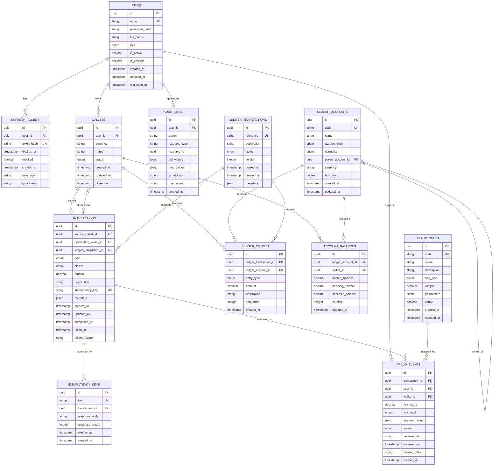

# FinLedger Database Schema

## Entity Relationship Diagram



## SQL Schema (PostgreSQL 16+)

```sql
-- Enable required extensions
CREATE EXTENSION IF NOT EXISTS "uuid-ossp";
CREATE EXTENSION IF NOT EXISTS "pgcrypto";
CREATE EXTENSION IF NOT EXISTS "btree_gin";

-- Custom enum types
CREATE TYPE user_role AS ENUM ('USER', 'ADMIN', 'COMPLIANCE', 'SYSTEM');
CREATE TYPE wallet_status AS ENUM ('ACTIVE', 'FROZEN', 'CLOSED', 'PENDING_VERIFICATION');
CREATE TYPE transaction_type AS ENUM ('DEPOSIT', 'WITHDRAWAL', 'TRANSFER_IN', 'TRANSFER_OUT', 'FEE', 'REVERSAL', 'ADJUSTMENT');
CREATE TYPE transaction_status AS ENUM ('PENDING', 'PROCESSING', 'COMPLETED', 'FAILED', 'BLOCKED', 'REVERSED', 'CANCELLED');
CREATE TYPE account_type AS ENUM ('ASSET', 'LIABILITY', 'EQUITY', 'REVENUE', 'EXPENSE');
CREATE TYPE account_normality AS ENUM ('DEBIT', 'CREDIT');
CREATE TYPE ledger_entry_type AS ENUM ('DEBIT', 'CREDIT');
CREATE TYPE ledger_txn_status AS ENUM ('DRAFT', 'POSTED', 'VOIDED');
CREATE TYPE fraud_rule_type AS ENUM ('VELOCITY', 'AMOUNT_THRESHOLD', 'COUNTERPARTY_FREQUENCY', 'SUSPICIOUS_PATTERN', 'GEO_VELOCITY', 'ML_SCORE');
CREATE TYPE fraud_risk_level AS ENUM ('LOW', 'MEDIUM', 'HIGH', 'CRITICAL');
CREATE TYPE fraud_event_status AS ENUM ('PENDING_REVIEW', 'APPROVED', 'BLOCKED', 'FALSE_POSITIVE', 'ESCALATED');

-- =============================================================================
-- USERS & AUTHENTICATION
-- =============================================================================

CREATE TABLE users (
    id UUID PRIMARY KEY DEFAULT uuid_generate_v4(),
    email VARCHAR(255) NOT NULL UNIQUE,
    password_hash VARCHAR(255) NOT NULL,
    full_name VARCHAR(255) NOT NULL,
    role user_role NOT NULL DEFAULT 'USER',
    is_active BOOLEAN NOT NULL DEFAULT TRUE,
    is_verified BOOLEAN NOT NULL DEFAULT FALSE,
    email_verification_token VARCHAR(255),
    email_verification_expires_at TIMESTAMPTZ,
    password_reset_token VARCHAR(255),
    password_reset_expires_at TIMESTAMPTZ,
    failed_login_attempts INTEGER NOT NULL DEFAULT 0,
    locked_until TIMESTAMPTZ,
    last_login_at TIMESTAMPTZ,
    created_at TIMESTAMPTZ NOT NULL DEFAULT NOW(),
    updated_at TIMESTAMPTZ NOT NULL DEFAULT NOW()
);

CREATE INDEX idx_users_email ON users(email);
CREATE INDEX idx_users_role ON users(role);
CREATE INDEX idx_users_is_active ON users(is_active) WHERE is_active = TRUE;

CREATE TABLE refresh_tokens (
    id UUID PRIMARY KEY DEFAULT uuid_generate_v4(),
    user_id UUID NOT NULL REFERENCES users(id) ON DELETE CASCADE,
    token_hash VARCHAR(255) NOT NULL UNIQUE,
    expires_at TIMESTAMPTZ NOT NULL,
    revoked BOOLEAN NOT NULL DEFAULT FALSE,
    revoked_at TIMESTAMPTZ,
    revoked_reason VARCHAR(255),
    user_agent TEXT,
    ip_address INET,
    created_at TIMESTAMPTZ NOT NULL DEFAULT NOW()
);

CREATE INDEX idx_refresh_tokens_user_id ON refresh_tokens(user_id);
CREATE INDEX idx_refresh_tokens_expires_at ON refresh_tokens(expires_at) WHERE revoked = FALSE;
CREATE INDEX idx_refresh_tokens_token_hash ON refresh_tokens(token_hash);

-- =============================================================================
-- WALLETS
-- =============================================================================

CREATE TABLE wallets (
    id UUID PRIMARY KEY DEFAULT uuid_generate_v4(),
    user_id UUID NOT NULL REFERENCES users(id) ON DELETE CASCADE,
    currency CHAR(3) NOT NULL, -- ISO 4217
    name VARCHAR(255) NOT NULL,
    status wallet_status NOT NULL DEFAULT 'PENDING_VERIFICATION',
    settings JSONB NOT NULL DEFAULT '{}',
    created_at TIMESTAMPTZ NOT NULL DEFAULT NOW(),
    updated_at TIMESTAMPTZ NOT NULL DEFAULT NOW(),
    closed_at TIMESTAMPTZ,
    
    CONSTRAINT chk_currency_length CHECK (LENGTH(currency) = 3)
);

CREATE INDEX idx_wallets_user_id ON wallets(user_id);
CREATE INDEX idx_wallets_currency ON wallets(currency);
CREATE INDEX idx_wallets_status ON wallets(status);
CREATE UNIQUE INDEX idx_wallets_user_currency_name ON wallets(user_id, currency, name) 
    WHERE status IN ('ACTIVE', 'PENDING_VERIFICATION');

-- =============================================================================
-- LEDGER - CHART OF ACCOUNTS
-- =============================================================================

CREATE TABLE ledger_accounts (
    id UUID PRIMARY KEY DEFAULT uuid_generate_v4(),
    code VARCHAR(50) NOT NULL UNIQUE, -- e.g., "1000", "2000", "4000"
    name VARCHAR(255) NOT NULL,
    account_type account_type NOT NULL,
    normality account_normality NOT NULL,
    parent_account_id UUID REFERENCES ledger_accounts(id) ON DELETE SET NULL,
    currency CHAR(3),
    description TEXT,
    is_active BOOLEAN NOT NULL DEFAULT TRUE,
    is_system_account BOOLEAN NOT NULL DEFAULT FALSE, -- Cannot be deleted
    created_at TIMESTAMPTZ NOT NULL DEFAULT NOW(),
    updated_at TIMESTAMPTZ NOT NULL DEFAULT NOW(),
    
    CONSTRAINT chk_currency_length CHECK (currency IS NULL OR LENGTH(currency) = 3)
);

CREATE INDEX idx_ledger_accounts_code ON ledger_accounts(code);
CREATE INDEX idx_ledger_accounts_parent ON ledger_accounts(parent_account_id);
CREATE INDEX idx_ledger_accounts_type ON ledger_accounts(account_type);
CREATE INDEX idx_ledger_accounts_active ON ledger_accounts(is_active) WHERE is_active = TRUE;

-- Materialized path for hierarchy queries
ALTER TABLE ledger_accounts ADD COLUMN path LTREE;
CREATE INDEX idx_ledger_accounts_path ON ledger_accounts USING GIST(path);

-- =============================================================================
-- LEDGER - TRANSACTIONS & ENTRIES
-- =============================================================================

CREATE TABLE ledger_transactions (
    id UUID PRIMARY KEY DEFAULT uuid_generate_v4(),
    reference VARCHAR(100) NOT NULL UNIQUE, -- Human-readable reference
    description TEXT NOT NULL,
    status ledger_txn_status NOT NULL DEFAULT 'DRAFT',
    version INTEGER NOT NULL DEFAULT 1, -- Optimistic locking
    posted_at TIMESTAMPTZ,
    voided_at TIMESTAMPTZ,
    voided_reason TEXT,
    metadata JSONB NOT NULL DEFAULT '{}',
    created_at TIMESTAMPTZ NOT NULL DEFAULT NOW(),
    updated_at TIMESTAMPTZ NOT NULL DEFAULT NOW()
);

CREATE INDEX idx_ledger_transactions_reference ON ledger_transactions(reference);
CREATE INDEX idx_ledger_transactions_status ON ledger_transactions(status);
CREATE INDEX idx_ledger_transactions_posted_at ON ledger_transactions(posted_at) 
    WHERE status = 'POSTED';

CREATE TABLE ledger_entries (
    id UUID PRIMARY KEY DEFAULT uuid_generate_v4(),
    ledger_transaction_id UUID NOT NULL REFERENCES ledger_transactions(id) ON DELETE CASCADE,
    ledger_account_id UUID NOT NULL REFERENCES ledger_accounts(id) ON DELETE RESTRICT,
    entry_type ledger_entry_type NOT NULL,
    amount NUMERIC(19, 4) NOT NULL, -- 4 decimal places for sub-cent precision
    description TEXT,
    sequence INTEGER NOT NULL, -- Order within transaction
    metadata JSONB NOT NULL DEFAULT '{}',
    created_at TIMESTAMPTZ NOT NULL DEFAULT NOW(),
    
    CONSTRAINT chk_amount_positive CHECK (amount > 0)
);

CREATE INDEX idx_ledger_entries_txn_id ON ledger_entries(ledger_transaction_id);
CREATE INDEX idx_ledger_entries_account_id ON ledger_entries(ledger_account_id);
CREATE INDEX idx_ledger_entries_type ON ledger_entries(entry_type);

-- Composite index for balance computation
CREATE INDEX idx_ledger_entries_account_posted ON ledger_entries(ledger_account_id, ledger_transaction_id)
    INCLUDE (entry_type, amount);

-- =============================================================================
-- TRANSACTIONS (Business-level)
-- =============================================================================

CREATE TABLE transactions (
    id UUID PRIMARY KEY DEFAULT uuid_generate_v4(),
    source_wallet_id UUID REFERENCES wallets(id) ON DELETE SET NULL,
    destination_wallet_id UUID REFERENCES wallets(id) ON DELETE SET NULL,
    ledger_transaction_id UUID REFERENCES ledger_transactions(id) ON DELETE SET NULL,
    type transaction_type NOT NULL,
    status transaction_status NOT NULL DEFAULT 'PENDING',
    amount NUMERIC(19, 4) NOT NULL,
    currency CHAR(3) NOT NULL,
    description TEXT,
    idempotency_key VARCHAR(255) NOT NULL UNIQUE,
    metadata JSONB NOT NULL DEFAULT '{}',
    failure_reason TEXT,
    failure_code VARCHAR(50),
    retry_count INTEGER NOT NULL DEFAULT 0,
    max_retries INTEGER NOT NULL DEFAULT 3,
    created_at TIMESTAMPTZ NOT NULL DEFAULT NOW(),
    updated_at TIMESTAMPTZ NOT NULL DEFAULT NOW(),
    completed_at TIMESTAMPTZ,
    failed_at TIMESTAMPTZ,
    
    CONSTRAINT chk_amount_positive CHECK (amount > 0),
    CONSTRAINT chk_currency_length CHECK (LENGTH(currency) = 3),
    CONSTRAINT chk_wallets_different CHECK (
        source_wallet_id IS NULL OR destination_wallet_id IS NULL OR 
        source_wallet_id != destination_wallet_id
    )
);

CREATE INDEX idx_transactions_source_wallet ON transactions(source_wallet_id);
CREATE INDEX idx_transactions_dest_wallet ON transactions(destination_wallet_id);
CREATE INDEX idx_transactions_status ON transactions(status);
CREATE INDEX idx_transactions_type ON transactions(type);
CREATE INDEX idx_transactions_idempotency ON transactions(idempotency_key);
CREATE INDEX idx_transactions_created_at ON transactions(created_at DESC);
CREATE INDEX idx_transactions_ledger_txn ON transactions(ledger_transaction_id);

-- Composite index for wallet transaction history
CREATE INDEX idx_transactions_wallet_created ON transactions(source_wallet_id, created_at DESC)
    INCLUDE (type, amount, status, description);

-- =============================================================================
-- ACCOUNT BALANCES (Materialized Views)
-- =============================================================================

CREATE TABLE account_balances (
    id UUID PRIMARY KEY DEFAULT uuid_generate_v4(),
    ledger_account_id UUID NOT NULL REFERENCES ledger_accounts(id) ON DELETE CASCADE,
    wallet_id UUID REFERENCES wallets(id) ON DELETE CASCADE,
    -- For system accounts (not wallet-specific), wallet_id is NULL
    
    posted_balance NUMERIC(19, 4) NOT NULL DEFAULT 0,
    pending_balance NUMERIC(19, 4) NOT NULL DEFAULT 0,
    available_balance NUMERIC(19, 4) NOT NULL DEFAULT 0,
    
    version INTEGER NOT NULL DEFAULT 1, -- Optimistic locking
    last_transaction_id UUID, -- Last ledger_transaction that updated this
    updated_at TIMESTAMPTZ NOT NULL DEFAULT NOW(),
    
    CONSTRAINT chk_one_wallet_or_system CHECK (
        (wallet_id IS NOT NULL AND ledger_account_id IS NOT NULL) OR
        (wallet_id IS NULL AND ledger_account_id IS NOT NULL)
    ),
    CONSTRAINT uq_account_wallet UNIQUE (ledger_account_id, wallet_id)
);

CREATE INDEX idx_account_balances_account ON account_balances(ledger_account_id);
CREATE INDEX idx_account_balances_wallet ON account_balances(wallet_id);

-- =============================================================================
-- FRAUD DETECTION
-- =============================================================================

CREATE TABLE fraud_rules (
    id UUID PRIMARY KEY DEFAULT uuid_generate_v4(),
    code VARCHAR(50) NOT NULL UNIQUE, -- e.g., "VELOCITY_10PM", "LARGE_TXN_P95"
    name VARCHAR(255) NOT NULL,
    description TEXT,
    rule_type fraud_rule_type NOT NULL,
    weight NUMERIC(4, 3) NOT NULL DEFAULT 0.100, -- 0.000 to 1.000
    parameters JSONB NOT NULL DEFAULT '{}', -- Rule-specific config
    active BOOLEAN NOT NULL DEFAULT TRUE,
    priority INTEGER NOT NULL DEFAULT 100, -- Lower = runs first
    created_at TIMESTAMPTZ NOT NULL DEFAULT NOW(),
    updated_at TIMESTAMPTZ NOT NULL DEFAULT NOW()
);

CREATE INDEX idx_fraud_rules_active ON fraud_rules(active) WHERE active = TRUE;
CREATE INDEX idx_fraud_rules_priority ON fraud_rules(priority);

CREATE TABLE fraud_events (
    id UUID PRIMARY KEY DEFAULT uuid_generate_v4(),
    transaction_id UUID NOT NULL REFERENCES transactions(id) ON DELETE CASCADE,
    user_id UUID NOT NULL REFERENCES users(id) ON DELETE CASCADE,
    wallet_id UUID NOT NULL REFERENCES wallets(id) ON DELETE CASCADE,
    risk_score NUMERIC(4, 3) NOT NULL, -- 0.000 to 1.000
    risk_level fraud_risk_level NOT NULL,
    triggered_rules JSONB NOT NULL DEFAULT '[]', -- Array of {rule_id, rule_code, weight, triggered}
    status fraud_event_status NOT NULL DEFAULT 'PENDING_REVIEW',
    reviewer_id UUID REFERENCES users(id) ON DELETE SET NULL,
    reviewed_at TIMESTAMPTZ,
    review_notes TEXT,
    auto_blocked BOOLEAN NOT NULL DEFAULT FALSE,
    created_at TIMESTAMPTZ NOT NULL DEFAULT NOW(),
    updated_at TIMESTAMPTZ NOT NULL DEFAULT NOW()
);

CREATE INDEX idx_fraud_events_transaction ON fraud_events(transaction_id);
CREATE INDEX idx_fraud_events_user ON fraud_events(user_id);
CREATE INDEX idx_fraud_events_wallet ON fraud_events(wallet_id);
CREATE INDEX idx_fraud_events_risk_level ON fraud_events(risk_level);
CREATE INDEX idx_fraud_events_status ON fraud_events(status);
CREATE INDEX idx_fraud_events_created_at ON fraud_events(created_at DESC);

-- =============================================================================
-- IDEMPOTENCY KEYS
-- =============================================================================

CREATE TABLE idempotency_keys (
    id UUID PRIMARY KEY DEFAULT uuid_generate_v4(),
    key VARCHAR(255) NOT NULL UNIQUE,
    transaction_id UUID REFERENCES transactions(id) ON DELETE SET NULL,
    request_method VARCHAR(10) NOT NULL,
    request_path VARCHAR(500) NOT NULL,
    request_body JSONB,
    response_status INTEGER,
    response_body JSONB,
    expires_at TIMESTAMPTZ NOT NULL,
    created_at TIMESTAMPTZ NOT NULL DEFAULT NOW()
);

CREATE INDEX idx_idempotency_keys_expires ON idempotency_keys(expires_at);
CREATE INDEX idx_idempotency_keys_txn ON idempotency_keys(transaction_id);

-- =============================================================================
-- AUDIT LOGS
-- =============================================================================

CREATE TABLE audit_logs (
    id UUID PRIMARY KEY DEFAULT uuid_generate_v4(),
    user_id UUID REFERENCES users(id) ON DELETE SET NULL,
    action VARCHAR(100) NOT NULL, -- e.g., "wallet.create", "transfer.execute"
    resource_type VARCHAR(100) NOT NULL, -- e.g., "wallet", "transaction"
    resource_id UUID,
    old_values JSONB,
    new_values JSONB,
    ip_address INET,
    user_agent TEXT,
    request_id VARCHAR(100), -- Correlation ID
    created_at TIMESTAMPTZ NOT NULL DEFAULT NOW()
);

CREATE INDEX idx_audit_logs_user ON audit_logs(user_id);
CREATE INDEX idx_audit_logs_resource ON audit_logs(resource_type, resource_id);
CREATE INDEX idx_audit_logs_action ON audit_logs(action);
CREATE INDEX idx_audit_logs_created_at ON audit_logs(created_at DESC);
CREATE INDEX idx_audit_logs_request_id ON audit_logs(request_id);

-- Partition audit_logs by month for performance
-- (Run this after initial creation)
-- CREATE TABLE audit_logs_2024_01 PARTITION OF audit_logs
--     FOR VALUES FROM ('2024-01-01') TO ('2024-02-01');

-- =============================================================================
-- TRIGGERS & FUNCTIONS
-- =============================================================================

-- Updated_at trigger function
CREATE OR REPLACE FUNCTION update_updated_at_column()
RETURNS TRIGGER AS $$
BEGIN
    NEW.updated_at = NOW();
    RETURN NEW;
END;
$$ LANGUAGE plpgsql;

-- Apply updated_at triggers
CREATE TRIGGER update_users_updated_at BEFORE UPDATE ON users
    FOR EACH ROW EXECUTE FUNCTION update_updated_at_column();

CREATE TRIGGER update_wallets_updated_at BEFORE UPDATE ON wallets
    FOR EACH ROW EXECUTE FUNCTION update_updated_at_column();

CREATE TRIGGER update_ledger_accounts_updated_at BEFORE UPDATE ON ledger_accounts
    FOR EACH ROW EXECUTE FUNCTION update_updated_at_column();

CREATE TRIGGER update_ledger_transactions_updated_at BEFORE UPDATE ON ledger_transactions
    FOR EACH ROW EXECUTE FUNCTION update_updated_at_column();

CREATE TRIGGER update_transactions_updated_at BEFORE UPDATE ON transactions
    FOR EACH ROW EXECUTE FUNCTION update_updated_at_column();

CREATE TRIGGER update_fraud_rules_updated_at BEFORE UPDATE ON fraud_rules
    FOR EACH ROW EXECUTE FUNCTION update_updated_at_column();

CREATE TRIGGER update_fraud_events_updated_at BEFORE UPDATE ON fraud_events
    FOR EACH ROW EXECUTE FUNCTION update_updated_at_column();

-- Ledger entry balance validation trigger
CREATE OR REPLACE FUNCTION validate_ledger_transaction_balance()
RETURNS TRIGGER AS $$
DECLARE
    debit_total NUMERIC(19, 4);
    credit_total NUMERIC(19, 4);
BEGIN
    -- Only validate on POSTED status
    IF NEW.status = 'POSTED' AND (OLD.status IS NULL OR OLD.status != 'POSTED') THEN
        SELECT COALESCE(SUM(amount), 0) INTO debit_total
        FROM ledger_entries
        WHERE ledger_transaction_id = NEW.id AND entry_type = 'DEBIT';
        
        SELECT COALESCE(SUM(amount), 0) INTO credit_total
        FROM ledger_entries
        WHERE ledger_transaction_id = NEW.id AND entry_type = 'CREDIT';
        
        IF debit_total != credit_total THEN
            RAISE EXCEPTION 'Ledger transaction % not balanced: debits=%, credits=%', 
                NEW.id, debit_total, credit_total;
        END IF;
    END IF;
    RETURN NEW;
END;
$$ LANGUAGE plpgsql;

CREATE TRIGGER validate_ledger_balance BEFORE UPDATE ON ledger_transactions
    FOR EACH ROW EXECUTE FUNCTION validate_ledger_transaction_balance();

-- =============================================================================
-- INITIAL DATA - CHART OF ACCOUNTS (Standard Financial Services)
-- =============================================================================

-- Assets
INSERT INTO ledger_accounts (code, name, account_type, normality, is_system_account, description) VALUES
('1000', 'Cash & Cash Equivalents', 'ASSET', 'DEBIT', TRUE, 'Physical and digital cash'),
('1010', 'Customer Wallets - USD', 'ASSET', 'DEBIT', TRUE, 'End-user USD wallet balances'),
('1011', 'Customer Wallets - EUR', 'ASSET', 'DEBIT', TRUE, 'End-user EUR wallet balances'),
('1012', 'Customer Wallets - GBP', 'ASSET', 'DEBIT', TRUE, 'End-user GBP wallet balances'),
('1020', 'Operating Bank Accounts', 'ASSET', 'DEBIT', TRUE, 'Company operational bank accounts'),
('1030', 'Settlement Accounts', 'ASSET', 'DEBIT', TRUE, 'Pending settlement with payment rails'),
('1040', 'Receivables', 'ASSET', 'DEBIT', TRUE, 'Amounts owed to the platform'),
('1050', 'Prepaid Expenses', 'ASSET', 'DEBIT', TRUE, 'Prepaid vendor expenses');

-- Liabilities
INSERT INTO ledger_accounts (code, name, account_type, normality, is_system_account, description) VALUES
('2000', 'Customer Liabilities', 'LIABILITY', 'CREDIT', TRUE, 'Funds held on behalf of customers'),
('2010', 'Customer Liabilities - USD', 'LIABILITY', 'CREDIT', TRUE, 'USD customer fund obligations'),
('2011', 'Customer Liabilities - EUR', 'LIABILITY', 'CREDIT', TRUE, 'EUR customer fund obligations'),
('2012', 'Customer Liabilities - GBP', 'LIABILITY', 'CREDIT', TRUE, 'GBP customer fund obligations'),
('2020', 'Accounts Payable', 'LIABILITY', 'CREDIT', TRUE, 'Amounts owed to vendors'),
('2030', 'Accrued Expenses', 'LIABILITY', 'CREDIT', TRUE, 'Expenses incurred but not paid'),
('2040', 'Deferred Revenue', 'LIABILITY', 'CREDIT', TRUE, 'Revenue received but not earned'),
('2050', 'Settlement Payables', 'LIABILITY', 'CREDIT', TRUE, 'Pending payouts to payment rails');

-- Equity
INSERT INTO ledger_accounts (code, name, account_type, normality, is_system_account, description) VALUES
('3000', 'Platform Equity', 'EQUITY', 'CREDIT', TRUE, 'Platform retained earnings'),
('3010', 'Fee Revenue', 'EQUITY', 'CREDIT', TRUE, 'Net fee income'),
('3020', 'Interest Income', 'EQUITY', 'CREDIT', TRUE, 'Net interest margin');

-- Revenue
INSERT INTO ledger_accounts (code, name, account_type, normality, is_system_account, description) VALUES
('4000', 'Transaction Fees', 'REVENUE', 'CREDIT', TRUE, 'Fees charged on transactions'),
('4010', 'Transfer Fees', 'REVENUE', 'CREDIT', TRUE, 'Fees on wallet-to-wallet transfers'),
('4020', 'Deposit Fees', 'REVENUE', 'CREDIT', TRUE, 'Fees on deposits'),
('4030', 'Withdrawal Fees', 'REVENUE', 'CREDIT', TRUE, 'Fees on withdrawals'),
('4040', 'FX Spread Revenue', 'REVENUE', 'CREDIT', TRUE, 'Revenue from FX markups'),
('4050', 'Interest Revenue', 'REVENUE', 'CREDIT', TRUE, 'Interest earned on float');

-- Expenses
INSERT INTO ledger_accounts (code, name, account_type, normality, is_system_account, description) VALUES
('5000', 'Payment Processing Fees', 'EXPENSE', 'DEBIT', TRUE, 'Fees paid to payment processors'),
('5010', 'Bank Fees', 'EXPENSE', 'DEBIT', TRUE, 'Bank service charges'),
('5020', 'Network Fees', 'EXPENSE', 'DEBIT', TRUE, 'Card network / rail fees'),
('5030', 'Fraud Losses', 'EXPENSE', 'DEBIT', TRUE, 'Net fraud write-offs'),
('5040', 'Operational Expenses', 'EXPENSE', 'DEBIT', TRUE, 'General operational costs');

-- =============================================================================
-- INITIAL DATA - FRAUD RULES
-- =============================================================================

INSERT INTO fraud_rules (code, name, description, rule_type, weight, parameters, priority) VALUES
('VELOCITY_10PM', 'High Velocity - 10 Transactions/Minute', 
 'Triggers when a user exceeds 10 transactions in a rolling 1-minute window',
 'VELOCITY', 0.30, '{"window_seconds": 60, "threshold": 10, "scope": "user"}', 10),

('VELOCITY_50PH', 'High Velocity - 50 Transactions/Hour',
 'Triggers when a user exceeds 50 transactions in a rolling 1-hour window',
 'VELOCITY', 0.25, '{"window_seconds": 3600, "threshold": 50, "scope": "user"}', 20),

('VELOCITY_WALLET_20PM', 'Wallet Velocity - 20 Transactions/Minute',
 'Triggers when a wallet exceeds 20 transactions in a rolling 1-minute window',
 'VELOCITY', 0.20, '{"window_seconds": 60, "threshold": 20, "scope": "wallet"}', 30),

('LARGE_TXN_P95', 'Large Transaction - Above 95th Percentile',
 'Triggers when transaction amount exceeds the 95th percentile for the user',
 'AMOUNT_THRESHOLD', 0.35, '{"percentile": 95, "lookback_days": 90, "min_transactions": 10}', 40),

('LARGE_TXN_ABS_10K', 'Large Transaction - Absolute > $10,000',
 'Triggers on any single transaction exceeding $10,000 (or currency equivalent)',
 'AMOUNT_THRESHOLD', 0.40, '{"threshold_usd": 10000}', 50),

('FREQUENT_COUNTERPARTY', 'Frequent Counterparty - >5 Transfers/Day',
 'Triggers when >5 transfers to the same counterparty in 24 hours',
 'COUNTERPARTY_FREQUENCY', 0.20, '{"window_hours": 24, "threshold": 5}', 60),

('ROUND_NUMBER', 'Suspicious Round Number Amount',
 'Triggers on suspiciously round amounts (e.g., $1000, $5000, $10000)',
 'SUSPICIOUS_PATTERN', 0.15, '{"round_thresholds": [100, 500, 1000, 5000, 10000], "tolerance": 0.01}', 70),

('JUST_UNDER_LIMIT', 'Just Under Reporting Limit',
 'Triggers on amounts just under common reporting thresholds (e.g., $9,999)',
 'SUSPICIOUS_PATTERN', 0.25, '{"thresholds": [9999, 4999, 2999, 999], "tolerance": 10}', 80),

('GEO_VELOCITY', 'Impossible Travel - Geo Velocity',
 'Triggers when transactions from geographically distant locations occur within impossible travel time',
 'GEO_VELOCITY', 0.30, '{"max_speed_kmh": 900, "min_distance_km": 500}', 90),

('NEW_DEVICE', 'New Device / IP',
 'Triggers on first transaction from a new device fingerprint or IP subnet',
 'SUSPICIOUS_PATTERN', 0.10, '{"lookback_days": 30}', 100);

-- =============================================================================
-- VIEWS FOR COMMON QUERIES
-- =============================================================================

-- Wallet balance summary (Posted, Pending, Available)
CREATE OR REPLACE VIEW wallet_balance_summary AS
SELECT 
    w.id AS wallet_id,
    w.user_id,
    w.currency,
    w.name,
    w.status,
    COALESCE(SUM(CASE WHEN la.account_type = 'ASSET' THEN ab.posted_balance ELSE 0 END), 0) -
    COALESCE(SUM(CASE WHEN la.account_type = 'LIABILITY' THEN ab.posted_balance ELSE 0 END), 0) AS posted_balance,
    COALESCE(SUM(CASE WHEN la.account_type = 'ASSET' THEN ab.pending_balance ELSE 0 END), 0) -
    COALESCE(SUM(CASE WHEN la.account_type = 'LIABILITY' THEN ab.pending_balance ELSE 0 END), 0) AS pending_balance,
    COALESCE(SUM(CASE WHEN la.account_type = 'ASSET' THEN ab.available_balance ELSE 0 END), 0) -
    COALESCE(SUM(CASE WHEN la.account_type = 'LIABILITY' THEN ab.available_balance ELSE 0 END), 0) AS available_balance
FROM wallets w
LEFT JOIN account_balances ab ON ab.wallet_id = w.id
LEFT JOIN ledger_accounts la ON la.id = ab.ledger_account_id
WHERE w.status IN ('ACTIVE', 'PENDING_VERIFICATION')
GROUP BY w.id, w.user_id, w.currency, w.name, w.status;

-- Transaction with fraud info
CREATE OR REPLACE VIEW transaction_with_fraud AS
SELECT 
    t.*,
    fe.risk_score,
    fe.risk_level,
    fe.status AS fraud_status,
    fe.triggered_rules
FROM transactions t
LEFT JOIN fraud_events fe ON fe.transaction_id = t.id;

-- Ledger trial balance
CREATE OR REPLACE VIEW ledger_trial_balance AS
SELECT 
    la.code,
    la.name,
    la.account_type,
    la.normality,
    COALESCE(SUM(CASE WHEN le.entry_type = 'DEBIT' THEN le.amount ELSE 0 END), 0) AS total_debits,
    COALESCE(SUM(CASE WHEN le.entry_type = 'CREDIT' THEN le.amount ELSE 0 END), 0) AS total_credits,
    COALESCE(SUM(CASE WHEN le.entry_type = 'DEBIT' THEN le.amount ELSE 0 END), 0) -
    COALESCE(SUM(CASE WHEN le.entry_type = 'CREDIT' THEN le.amount ELSE 0 END), 0) AS net_balance
FROM ledger_accounts la
LEFT JOIN ledger_entries le ON le.ledger_account_id = la.id
LEFT JOIN ledger_transactions lt ON lt.id = le.ledger_transaction_id AND lt.status = 'POSTED'
WHERE la.is_active = TRUE
GROUP BY la.id, la.code, la.name, la.account_type, la.normality
ORDER BY la.code;

-- =============================================================================
-- ROW LEVEL SECURITY (Optional - for multi-tenancy)
-- =============================================================================

-- ALTER TABLE wallets ENABLE ROW LEVEL SECURITY;
-- CREATE POLICY wallet_user_isolation ON wallets
--     FOR ALL TO application_role
--     USING (user_id = current_setting('app.current_user_id')::uuid);

-- ALTER TABLE transactions ENABLE ROW LEVEL SECURITY;
-- CREATE POLICY transaction_user_isolation ON transactions
--     FOR ALL TO application_role
--     USING (
--         source_wallet_id IN (SELECT id FROM wallets WHERE user_id = current_setting('app.current_user_id')::uuid)
--         OR destination_wallet_id IN (SELECT id FROM wallets WHERE user_id = current_setting('app.current_user_id')::uuid)
--     );
```

## Migration Strategy

```bash
# Generate initial migration
alembic revision --autogenerate -m "Initial schema"

# Run migrations
alembic upgrade head

# Create new migration for changes
alembic revision --autogenerate -m "Add fraud review workflow"

# Rollback
alembic downgrade -1
```

## Indexing Strategy

| Table | Index | Purpose |
|-------|-------|---------|
| `transactions` | `(source_wallet_id, created_at DESC)` | Wallet transaction history |
| `transactions` | `(destination_wallet_id, created_at DESC)` | Incoming transaction history |
| `ledger_entries` | `(ledger_account_id, ledger_transaction_id) INCLUDE (entry_type, amount)` | Balance computation |
| `account_balances` | `(ledger_account_id, wallet_id)` | Unique constraint + fast lookup |
| `fraud_events` | `(risk_level, status, created_at DESC)` | Review queue queries |
| `audit_logs` | `(resource_type, resource_id, created_at DESC)` | Resource audit trail |
| `refresh_tokens` | `(user_id, expires_at) WHERE revoked = FALSE` | Active token lookup |
| `idempotency_keys` | `(expires_at)` | Cleanup job |

## Partitioning Strategy (Future)

```sql
-- Partition audit_logs by month
CREATE TABLE audit_logs (
    -- columns...
) PARTITION BY RANGE (created_at);

-- Monthly partitions created automatically via pg_partman or cron job
CREATE TABLE audit_logs_2024_01 PARTITION OF audit_logs
    FOR VALUES FROM ('2024-01-01') TO ('2024-02-01');

-- Partition fraud_events by month for compliance retention
CREATE TABLE fraud_events (
    -- columns...
) PARTITION BY RANGE (created_at);
```