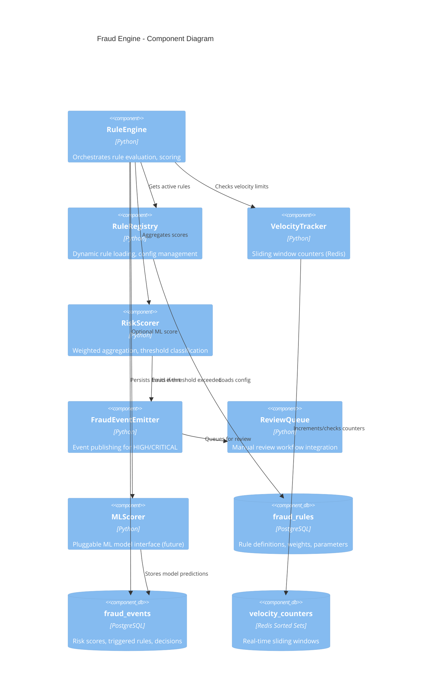
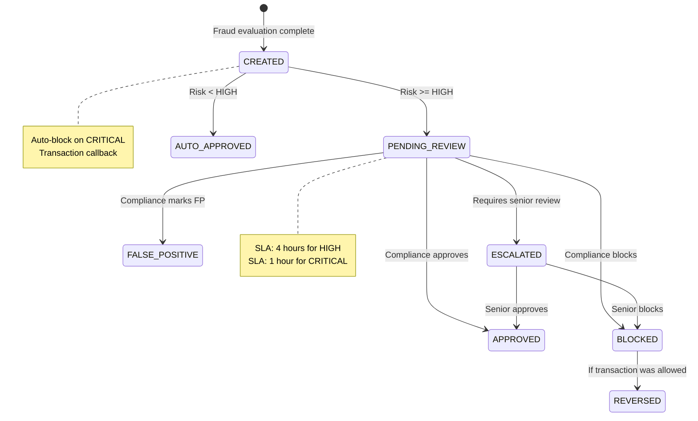

# FinLedger Fraud Detection Engine Architecture

## Overview

The fraud detection engine is a rule-based, real-time risk scoring system designed for explainability, auditability, and immediate deployment. It evaluates every transaction against configurable rules, producing a risk score (0.0-1.0) and risk level (LOW/MEDIUM/HIGH/CRITICAL).

## Architecture



## Rule Evaluation Pipeline

```mermaid
flowchart TD
    A[Transaction Context] --> B[Rule Registry\nLoad Active Rules]
    B --> C[Parallel Rule Evaluation]
    
    C --> D1[Velocity Rules\nRedis Sliding Windows]
    C --> D2[Amount Rules\nPercentile/Absolute]
    C --> D3[Counterparty Rules\nFrequency Analysis]
    C --> D4[Pattern Rules\nRound Numbers, Thresholds]
    C --> D5[Geo Rules\nImpossible Travel]
    C --> D6[ML Scorer\nOptional Model]
    
    D1 --> E[Collect Triggered Rules\n{rule_id, weight, triggered, evidence}]
    D2 --> E
    D3 --> E
    D4 --> E
    D5 --> E
    D6 --> E
    
    E --> F[Risk Scorer\nWeighted Sum]
    F --> G{Risk Level}
    G -->|LOW| H[Log Event\nAllow Transaction]
    G -->|MEDIUM| I[Log Event\nAllow + Monitor]
    G -->|HIGH| J[Log Event\nQueue for Review\nAllow Transaction]
    G -->|CRITICAL| K[Log Event\nBlock Transaction\nQueue for Review]
    
    H --> L[Persist Fraud Event]
    I --> L
    J --> L
    K --> L
```

## Rule Types & Implementation

### 1. Velocity Rules (Redis Sliding Windows)

```python
class VelocityRule(BaseRule):
    """Sliding window velocity check using Redis sorted sets"""
    
    async def evaluate(self, context: TransactionContext) -> RuleResult:
        # Key format: velocity:{scope}:{entity_id}
        key = f"velocity:{self.scope}:{getattr(context, f'{self.scope}_id')}"
        now = time.time()
        window_start = now - self.window_seconds
        
        # Add current request
        await redis.zadd(key, {str(context.transaction_id): now})
        await redis.expire(key, self.window_seconds + 60)
        
        # Count in window
        count = await redis.zcount(key, window_start, now)
        
        triggered = count > self.threshold
        evidence = {
            "count": count,
            "threshold": self.threshold,
            "window_seconds": self.window_seconds,
            "scope": self.scope
        }
        
        return RuleResult(
            rule_code=self.code,
            weight=self.weight,
            triggered=triggered,
            evidence=evidence
        )
```

**Configuration:**
```json
{
  "window_seconds": 60,
  "threshold": 10,
  "scope": "user"  // or "wallet", "ip", "device"
}
```

### 2. Amount Threshold Rules

```python
class AmountThresholdRule(BaseRule):
    """Checks against absolute or percentile-based thresholds"""
    
    async def evaluate(self, context: TransactionContext) -> RuleResult:
        amount = context.amount
        
        if self.threshold_type == "absolute":
            triggered = amount >= self.threshold_amount
            evidence = {"amount": str(amount), "threshold": str(self.threshold_amount)}
            
        elif self.threshold_type == "percentile":
            # Query user's historical amounts
            percentile_value = await self.get_user_percentile(
                context.user_id, 
                self.percentile, 
                self.lookback_days
            )
            triggered = amount >= percentile_value
            evidence = {
                "amount": str(amount),
                "percentile": self.percentile,
                "threshold_value": str(percentile_value)
            }
            
        return RuleResult(rule_code=self.code, weight=self.weight, triggered=triggered, evidence=evidence)
```

### 3. Counterparty Frequency Rules

```python
class CounterpartyFrequencyRule(BaseRule):
    """Detects excessive transfers to same counterparty"""
    
    async def evaluate(self, context: TransactionContext) -> RuleResult:
        if not context.destination_wallet_id:
            return RuleResult(rule_code=self.code, weight=self.weight, triggered=False)
        
        # Count transfers to this counterparty in window
        count = await db.scalar(
            select(func.count(Transaction.id))
            .where(Transaction.source_wallet_id == context.source_wallet_id)
            .where(Transaction.destination_wallet_id == context.destination_wallet_id)
            .where(Transaction.type == TransactionType.TRANSFER_OUT)
            .where(Transaction.created_at >= now() - timedelta(hours=self.window_hours))
            .where(Transaction.status == TransactionStatus.COMPLETED)
        )
        
        triggered = count >= self.threshold
        evidence = {"counterparty_transfers": count, "threshold": self.threshold}
        
        return RuleResult(rule_code=self.code, weight=self.weight, triggered=triggered, evidence=evidence)
```

### 4. Suspicious Pattern Rules

```python
class SuspiciousPatternRule(BaseRule):
    """Detects round numbers, just-under-limits, structuring"""
    
    PATTERNS = {
        "round_number": lambda amt, cfg: self._is_round(amt, cfg["thresholds"], cfg["tolerance"]),
        "just_under_limit": lambda amt, cfg: self._is_just_under(amt, cfg["thresholds"], cfg["tolerance"]),
        "structuring": lambda amt, cfg: self._detect_structuring(context, cfg)
    }
    
    async def evaluate(self, context: TransactionContext) -> RuleResult:
        amount = context.amount
        triggered_patterns = []
        
        for pattern_name, check_fn in self.PATTERNS.items():
            if pattern_name in self.enabled_patterns:
                config = self.pattern_configs[pattern_name]
                if check_fn(amount, config):
                    triggered_patterns.append(pattern_name)
        
        triggered = len(triggered_patterns) > 0
        evidence = {"triggered_patterns": triggered_patterns}
        
        return RuleResult(rule_code=self.code, weight=self.weight, triggered=triggered, evidence=evidence)
```

### 5. Geo Velocity Rules

```python
class GeoVelocityRule(BaseRule):
    """Impossible travel detection using IP geolocation"""
    
    async def evaluate(self, context: TransactionContext) -> RuleResult:
        if not context.ip_address:
            return RuleResult(rule_code=self.code, weight=self.weight, triggered=False)
        
        # Get last transaction location
        last_txn = await db.scalar(
            select(Transaction)
            .where(Transaction.user_id == context.user_id)
            .where(Transaction.ip_address.is_not(None))
            .order_by(Transaction.created_at.desc())
            .limit(1)
        )
        
        if not last_txn:
            return RuleResult(rule_code=self.code, weight=self.weight, triggered=False)
        
        # Calculate distance and time
        distance_km = self._haversine_distance(
            last_txn.ip_location, context.ip_location
        )
        time_diff_hours = (context.created_at - last_txn.created_at).total_seconds() / 3600
        
        # Impossible if distance > max_speed * time
        max_possible_km = self.max_speed_kmh * time_diff_hours
        triggered = distance_km > max_possible_km and distance_km > self.min_distance_km
        
        evidence = {
            "distance_km": distance_km,
            "time_diff_hours": time_diff_hours,
            "max_possible_km": max_possible_km,
            "last_location": last_txn.ip_location,
            "current_location": context.ip_location
        }
        
        return RuleResult(rule_code=self.code, weight=self.weight, triggered=triggered, evidence=evidence)
```

## Risk Scoring Algorithm

```python
class RiskScorer:
    """Weighted risk score aggregation with threshold classification"""
    
    # Risk level thresholds
    THRESHOLDS = {
        RiskLevel.LOW: 0.0,
        RiskLevel.MEDIUM: 0.3,
        RiskLevel.HIGH: 0.6,
        RiskLevel.CRITICAL: 0.85
    }
    
    def calculate(self, rule_results: list[RuleResult], ml_score: float = None) -> RiskAssessment:
        # Base score from rules
        rule_score = sum(r.weight for r in rule_results if r.triggered)
        
        # Normalize to 0-1 (max possible weight sum)
        max_possible = sum(r.weight for r in rule_results)
        normalized_rule_score = rule_score / max_possible if max_possible > 0 else 0
        
        # Incorporate ML score if available (weighted 30%)
        if ml_score is not None:
            final_score = 0.7 * normalized_rule_score + 0.3 * ml_score
        else:
            final_score = normalized_rule_score
        
        # Clamp
        final_score = min(1.0, max(0.0, final_score))
        
        # Determine level
        risk_level = RiskLevel.LOW
        for level, threshold in sorted(self.THRESHOLDS.items(), key=lambda x: x[1], reverse=True):
            if final_score >= threshold:
                risk_level = level
                break
        
        return RiskAssessment(
            risk_score=round(final_score, 3),
            risk_level=risk_level,
            triggered_rules=[r for r in rule_results if r.triggered],
            all_rules=rule_results
        )
```

## Fraud Event Lifecycle



## Database Schema (Fraud-Specific)

```sql
-- Fraud Rules (Configurable)
CREATE TABLE fraud_rules (
    id UUID PRIMARY KEY DEFAULT uuid_generate_v4(),
    code VARCHAR(50) NOT NULL UNIQUE,
    name VARCHAR(255) NOT NULL,
    description TEXT,
    rule_type fraud_rule_type NOT NULL,
    weight NUMERIC(4,3) NOT NULL DEFAULT 0.100,
    parameters JSONB NOT NULL DEFAULT '{}',
    active BOOLEAN NOT NULL DEFAULT TRUE,
    priority INTEGER NOT NULL DEFAULT 100,
    created_at TIMESTAMPTZ NOT NULL DEFAULT NOW(),
    updated_at TIMESTAMPTZ NOT NULL DEFAULT NOW()
);

-- Fraud Events (Audit Trail)
CREATE TABLE fraud_events (
    id UUID PRIMARY KEY DEFAULT uuid_generate_v4(),
    transaction_id UUID NOT NULL REFERENCES transactions(id),
    user_id UUID NOT NULL REFERENCES users(id),
    wallet_id UUID NOT NULL REFERENCES wallets(id),
    risk_score NUMERIC(4,3) NOT NULL,
    risk_level fraud_risk_level NOT NULL,
    triggered_rules JSONB NOT NULL DEFAULT '[]',
    status fraud_event_status NOT NULL DEFAULT 'PENDING_REVIEW',
    reviewer_id UUID REFERENCES users(id),
    reviewed_at TIMESTAMPTZ,
    review_notes TEXT,
    auto_blocked BOOLEAN NOT NULL DEFAULT FALSE,
    ml_score NUMERIC(4,3),
    ml_model_version VARCHAR(50),
    created_at TIMESTAMPTZ NOT NULL DEFAULT NOW(),
    updated_at TIMESTAMPTZ NOT NULL DEFAULT NOW()
);

-- Indexes for review queue
CREATE INDEX idx_fraud_events_review_queue 
    ON fraud_events(risk_level, status, created_at DESC) 
    WHERE status = 'PENDING_REVIEW';

CREATE INDEX idx_fraud_events_user_recent 
    ON fraud_events(user_id, created_at DESC);
```

## Redis Velocity Tracking

```python
# Key patterns
VELOCITY_KEYS = {
    "user": "vel:user:{user_id}",
    "wallet": "vel:wallet:{wallet_id}",
    "ip": "vel:ip:{ip_address}",
    "device": "vel:device:{device_fingerprint}"
}

# Sorted set: member=transaction_id, score=timestamp
# Cleanup: expire key after window + buffer

async def increment_velocity(scope: str, entity_id: str, txn_id: str, window_seconds: int):
    key = VELOCITY_KEYS[scope].format(**{scope: entity_id})
    now = time.time()
    
    pipe = redis.pipeline()
    pipe.zadd(key, {txn_id: now})
    pipe.zremrangebyscore(key, 0, now - window_seconds)
    pipe.expire(key, window_seconds + 60)
    await pipe.execute()

async def get_velocity_count(scope: str, entity_id: str, window_seconds: int) -> int:
    key = VELOCITY_KEYS[scope].format(**{scope: entity_id})
    now = time.time()
    return await redis.zcount(key, now - window_seconds, now)
```

## Integration with Transaction Flow

```python
class FraudService:
    """Main fraud evaluation entry point"""
    
    async def evaluate_transaction(self, context: TransactionContext) -> FraudAssessment:
        # 1. Increment velocity counters (non-blocking)
        asyncio.create_task(self._update_velocity_counters(context))
        
        # 2. Load active rules
        rules = await self.rule_registry.get_active_rules()
        
        # 3. Evaluate all rules in parallel
        rule_results = await asyncio.gather(*[
            rule.evaluate(context) for rule in rules
        ])
        
        # 4. Get ML score if enabled (future)
        ml_score = await self.ml_scorer.score(context) if self.ml_enabled else None
        
        # 5. Calculate risk
        assessment = self.risk_scorer.calculate(rule_results, ml_score)
        
        # 6. Persist fraud event
        fraud_event = await self._persist_fraud_event(context, assessment)
        
        # 7. Handle high-risk cases
        if assessment.risk_level in (RiskLevel.HIGH, RiskLevel.CRITICAL):
            await self.event_emitter.emit(fraud_event)
            
        if assessment.risk_level == RiskLevel.CRITICAL:
            # Signal transaction service to block
            await self._signal_block(context.transaction_id, fraud_event.id)
        
        return assessment
```

## Review Queue Integration

```python
class ReviewQueue:
    """Compliance team review workflow"""
    
    async def queue_for_review(self, fraud_event: FraudEvent):
        # Priority by risk level
        priority = {
            RiskLevel.CRITICAL: 1,
            RiskLevel.HIGH: 2,
            RiskLevel.MEDIUM: 3
        }[fraud_event.risk_level]
        
        # Add to review queue (Redis list or dedicated queue)
        await redis.lpush(
            f"review_queue:{priority}",
            json.dumps({
                "fraud_event_id": str(fraud_event.id),
                "transaction_id": str(fraud_event.transaction_id),
                "risk_level": fraud_event.risk_level.value,
                "risk_score": str(fraud_event.risk_score),
                "triggered_rules": fraud_event.triggered_rules,
                "created_at": fraud_event.created_at.isoformat()
            })
        )
        
        # Notify compliance team (webhook, email, Slack)
        await self._notify_compliance_team(fraud_event)
    
    async def get_review_batch(self, reviewer_id: str, limit: int = 20) -> list[ReviewItem]:
        # Fetch from highest priority queues first
        items = []
        for priority in [1, 2, 3]:
            while len(items) < limit:
                item = await redis.rpop(f"review_queue:{priority}")
                if not item:
                    break
                items.append(json.loads(item))
        return items
    
    async def submit_review(self, fraud_event_id: str, decision: ReviewDecision, reviewer: User):
        # Update fraud event
        await db.execute(
            update(FraudEvent)
            .where(FraudEvent.id == fraud_event_id)
            .values(
                status=decision.status,
                reviewer_id=reviewer.id,
                reviewed_at=now(),
                review_notes=decision.notes
            )
        )
        
        # If BLOCKED and transaction was allowed, trigger reversal
        if decision.status == FraudEventStatus.BLOCKED:
            await self._trigger_reversal(fraud_event_id)
```

## Metrics & Monitoring

| Metric | Type | Description |
|--------|------|-------------|
| `fraud_evaluation_duration_seconds` | Histogram | Time to evaluate all rules |
| `fraud_events_total` | Counter | By risk_level, status |
| `fraud_rule_triggered_total` | Counter | By rule_code |
| `fraud_review_queue_size` | Gauge | By priority |
| `fraud_review_sla_breach_total` | Counter | Reviews exceeding SLA |
| `fraud_false_positive_rate` | Gauge | Approved / (Approved + False Positive) |
| `fraud_block_rate` | Gauge | Blocked / Total |

## Testing Strategy

### Unit Tests
- [ ] Each rule type evaluates correctly
- [ ] Risk scorer calculates weighted sum correctly
- [ ] Threshold classification matches spec
- [ ] Velocity counter increments/expires correctly

### Integration Tests
- [ ] Full evaluation pipeline with real Redis/DB
- [ ] CRITICAL risk blocks transaction
- [ ] HIGH risk queues for review but allows
- [ ] Review decision updates fraud event
- [ ] Blocked transaction triggers reversal

### Load Tests
- [ ] 10,000 evaluations/second sustained
- [ ] p99 latency < 50ms
- [ ] Redis connection pooling handles load

### Chaos Tests
- [ ] Redis unavailable → fail-open (allow, log warning)
- [ ] DB unavailable → queue events locally, retry
- [ ] Rule config reload without restart

## Future: ML Integration

```python
class MLScorer:
    """Pluggable ML model interface"""
    
    async def score(self, context: TransactionContext) -> float:
        # Feature engineering
        features = self._extract_features(context)
        
        # Model inference (ONNX, TensorFlow Serving, etc.)
        score = await self.model.predict(features)
        
        # Log for training data
        await self._log_prediction(context, features, score)
        
        return score
    
    def _extract_features(self, context: TransactionContext) -> dict:
        return {
            "amount": float(context.amount),
            "user_txn_count_1h": await self._get_velocity(context.user_id, 3600),
            "user_txn_count_24h": await self._get_velocity(context.user_id, 86400),
            "avg_txn_amount_30d": await self._get_avg_amount(context.user_id, 30),
            "unique_counterparties_7d": await self._get_unique_counterparties(context.user_id, 7),
            "time_since_last_txn": (now() - context.last_txn_time).total_seconds(),
            "is_new_device": context.is_new_device,
            "is_new_ip": context.is_new_ip,
            "geo_distance_from_last": context.geo_distance_km
        }
```

## Configuration Management

Rules loaded from database at startup, hot-reloadable:
```python
class RuleRegistry:
    def __init__(self):
        self._rules: dict[str, BaseRule] = {}
        self._last_reload = 0
    
    async def reload(self):
        rules = await db.scalars(select(FraudRule).where(FraudRule.active == True))
        self._rules = {r.code: self._instantiate_rule(r) for r in rules}
        self._last_reload = time.time()
    
    async def get_active_rules(self) -> list[BaseRule]:
        # Auto-reload every 60 seconds
        if time.time() - self._last_reload > 60:
            await self.reload()
        return list(self._rules.values())
```