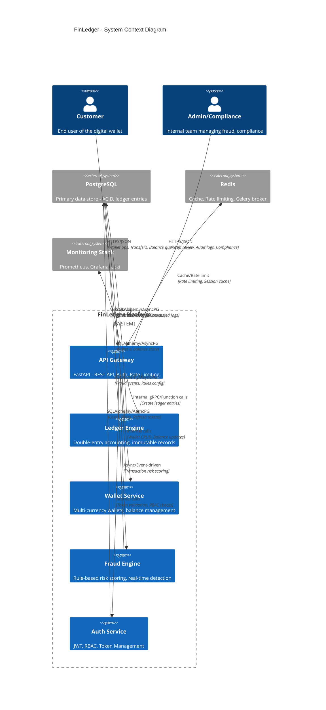
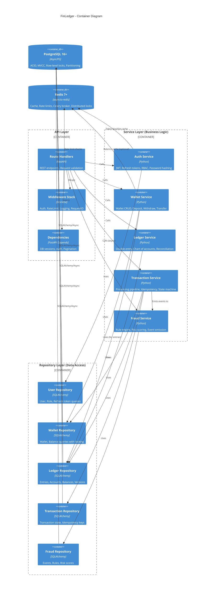
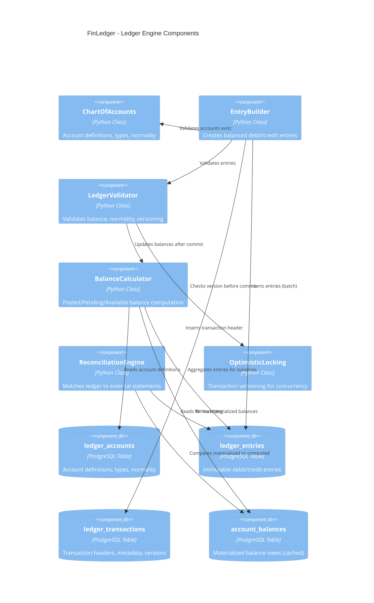
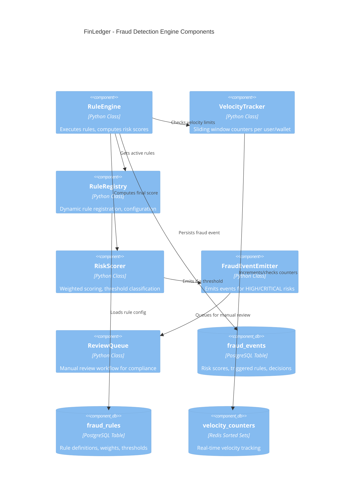
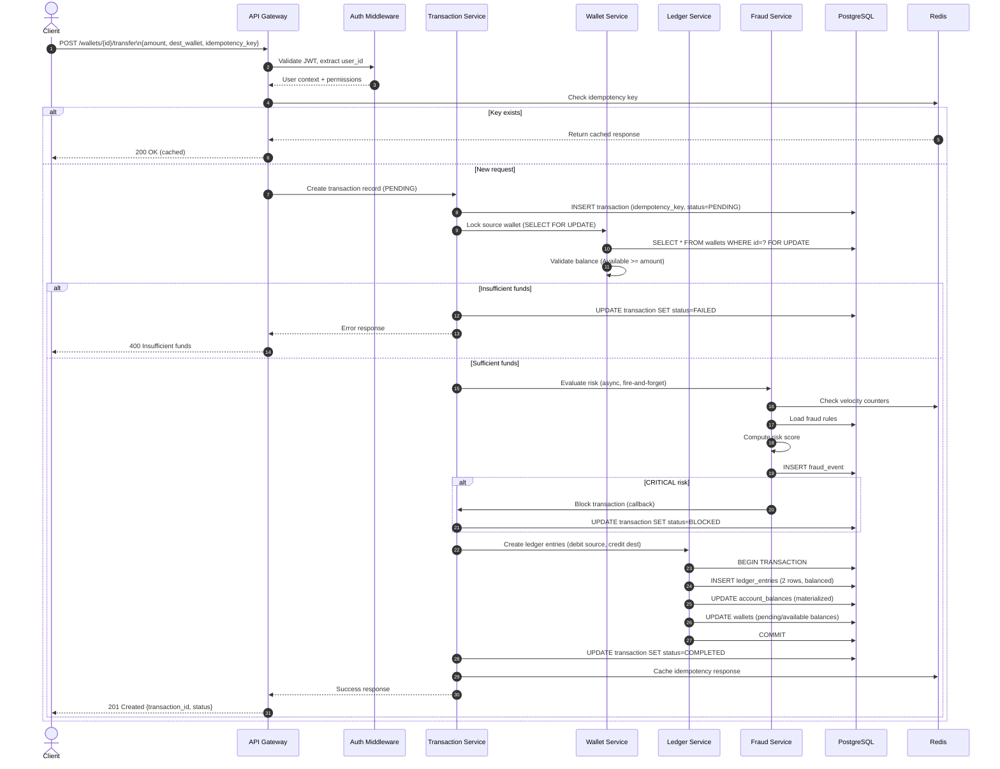
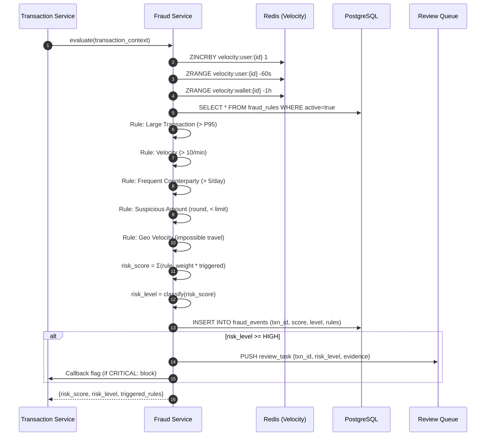
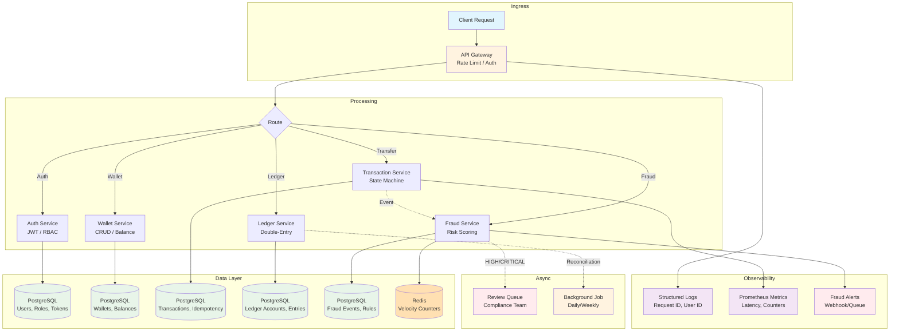

# FinLedger System Architecture

## High-Level Architecture



## Container Diagram



## Component Diagram - Ledger Engine



## Component Diagram - Fraud Engine



## Sequence Diagram - Transfer Flow



## Sequence Diagram - Fraud Detection



## Data Flow Diagram



## Deployment Architecture

```mermaid
C4Deployment
    title FinLedger - Deployment Architecture (Production)

    Deployment_Node(k8s, "Kubernetes Cluster (EKS/GKE/AKS)", "Container Orchestration") {
        Deployment_Node(ingress, "Ingress Controller\n(NGINX/Traefik)", "TLS Termination, Rate Limit") {
            Container(api_pods, "API Pods (x3+)", "FastAPI + Uvicorn", "Horizontal Pod Autoscaler")
        }
        Deployment_Node(worker, "Worker Nodes") {
            Container(celery, "Celery Workers", "Async Tasks", "Fraud, Reconciliation, Webhooks")
            Container(beat, "Celery Beat", "Cron Jobs", "Daily reconciliation, Cleanup")
        }
        Deployment_Node(monitoring_ns, "Monitoring Namespace") {
            Container(prom, "Prometheus", "Metrics Collection")
            Container(grafana, "Grafana", "Dashboards")
            Container(loki, "Loki", "Log Aggregation")
            Container(tempo, "Tempo", "Distributed Tracing")
        }
    }

    Deployment_Node(rds, "AWS RDS / Cloud SQL\nPostgreSQL 16+", "Managed Database") {
        ContainerDb(pg_primary, "Primary", "Read/Write", "Multi-AZ, Automated Backups")
        ContainerDb(pg_replica, "Read Replicas (x2)", "Read Only", "Connection Pooling (PgBouncer)")
    }

    Deployment_Node(elasticache, "ElastiCache / Memorystore\nRedis 7+", "Managed Redis") {
        Container(redis_cluster, "Redis Cluster", "Cache, Sessions, Rate Limit", "Multi-AZ, Auto-failover")
    }

    Deployment_Node(s3, "S3 / GCS", "Object Storage") {
        Container(backups, "Backup Bucket", "DB Backups, Audit Exports")
    }

    Deployment_Node(vault, "HashiCorp Vault / AWS Secrets Manager", "Secrets Management") {
        Container(secrets, "API Keys, DB Creds, JWT Secrets")
    }

    Rel(ingress, api_pods, "HTTPS/Load Balance")
    Rel(api_pods, pg_primary, "AsyncPG/Pool")
    Rel(api_pods, pg_replica, "Read Queries")
    Rel(api_pods, redis_cluster, "Cache/Rate Limit")
    Rel(celery, pg_primary, "AsyncPG/Pool")
    Rel(celery, redis_cluster, "Broker/Backend")
    Rel(api_pods, vault, "Secrets at Startup")
    Rel(prom, api_pods, "Scrape /metrics")
    Rel(loki, api_pods, "Collect Logs")
    Rel(tempo, api_pods, "Traces")
    Rel(pg_primary, backups, "Automated Snapshots")
```

---

## Architecture Decision Records (ADRs)

### ADR-001: Double-Entry Ledger as Core
**Status**: Accepted  
**Context**: Financial systems require immutable, auditable records. Single-entry systems lead to reconciliation nightmares.  
**Decision**: Implement a proper double-entry accounting engine from day one. Every financial movement creates balanced debit/credit entries.  
**Consequences**: More complex initial implementation, but eliminates entire classes of bugs and enables regulatory compliance.

### ADR-002: Optimistic Locking for Ledger Concurrency
**Status**: Accepted  
**Context**: High-throughput financial systems need concurrent transaction processing without deadlocks.  
**Decision**: Use optimistic locking with version columns on ledger_transactions and account_balances. Retry with exponential backoff on conflict.  
**Consequences**: Better throughput under contention vs pessimistic locking; requires idempotent retry logic in clients.

### ADR-003: Three Balance Types (Posted/Pending/Available)
**Status**: Accepted  
**Context**: Real-world wallets need different balance views for different use cases (Modern Treasury pattern).  
**Decision**: Implement three materialized balance types computed from ledger entries with different settlement filters.  
**Consequences**: More storage, but enables correct UX and compliance. Balance drift prevented by transactional updates.

### ADR-004: Rule-Based Fraud Engine (ML-Ready)
**Status**: Accepted  
**Context**: Need immediate fraud protection; ML models require training data and expertise.  
**Decision**: Build configurable rule engine first with clear extension points for ML scoring later.  
**Consequences**: Fast time-to-value, explainable decisions, audit-friendly. ML can be added as a weighted rule.

### ADR-005: Idempotency Keys for All Mutations
**Status**: Accepted  
**Context**: Network failures cause duplicate requests; financial operations must be exactly-once.  
**Decision**: Require `Idempotency-Key` header on all POST/PUT/PATCH. Store key+response in Redis with TTL.  
**Consequences**: Client responsibility, but eliminates duplicate charges. 24hr TTL covers retry windows.

### ADR-006: Async Fraud Evaluation
**Status**: Accepted  
**Context**: Fraud checks add latency; blocking on them hurts UX.  
**Decision**: Evaluate fraud asynchronously via event emission. Only block on CRITICAL risk via callback.  
**Consequences**: Sub-100ms transfer latency; slight risk of post-commit reversal for HIGH risk (handled by review queue).

### ADR-007: Materialized Balance Views
**Status**: Accepted  
**Context**: Computing balances from ledger entries on every read is O(n) and slow at scale.  
**Decision**: Maintain materialized `account_balances` table updated transactionally with ledger entries.  
**Consequences**: Write amplification on transfers, but O(1) balance reads. Reconciliation job verifies consistency.

---

## Non-Functional Requirements

| Requirement | Target | Implementation |
|-------------|--------|----------------|
| **Availability** | 99.95% | Multi-AZ, Health checks, Graceful degradation |
| **Latency (p99)** | < 200ms | Connection pooling, Async, Caching, Indexes |
| **Throughput** | 10,000 TPS | Horizontal scaling, Partitioning, Batch inserts |
| **Durability** | Zero data loss | PostgreSQL WAL, Synchronous replication |
| **Consistency** | Strong (ACID) | Serializable isolation for ledger, MVCC |
| **Auditability** | Complete | Immutable ledger, Structured audit logs |
| **Recoverability** | RPO < 1min, RTO < 5min | Point-in-time recovery, Automated failover |
| **Scalability** | Horizontal | Stateless API, Read replicas, Redis Cluster |