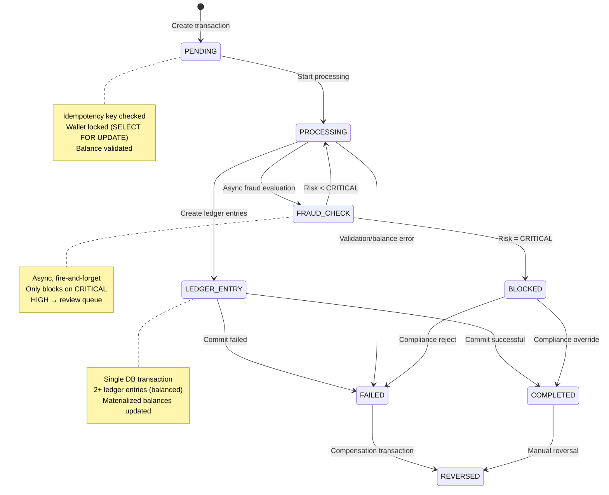
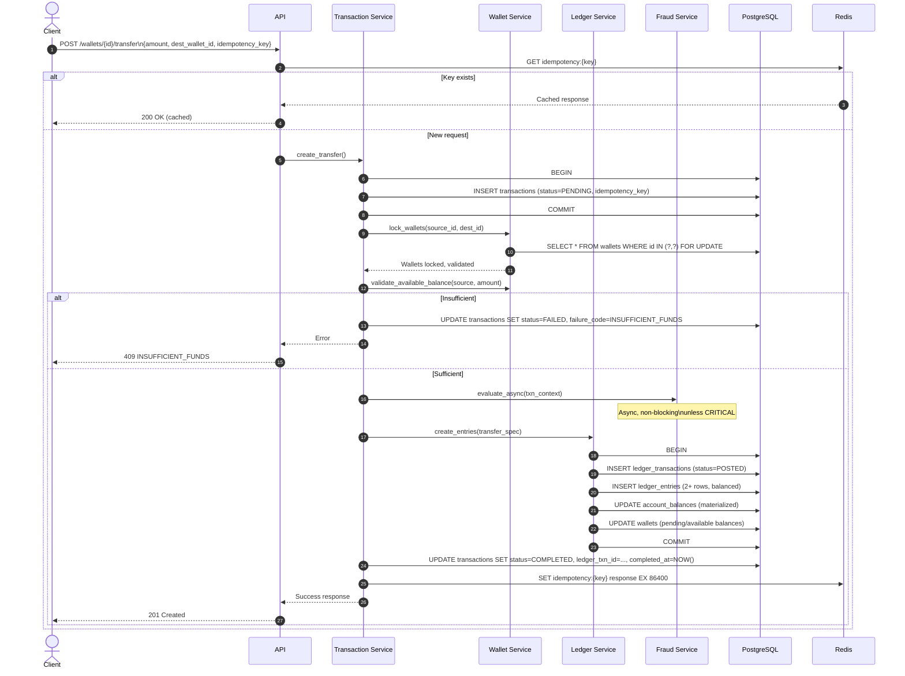

# FinLedger Transaction Lifecycle

## Overview

The transaction lifecycle in FinLedger follows a rigorous state machine ensuring data integrity, auditability, and exactly-once semantics for all financial movements.

## State Machine



## Transaction Types

| Type | Description | Ledger Impact |
|------|-------------|---------------|
| `DEPOSIT` | External funds into wallet | Debit: Settlement Asset / Credit: Customer Liability |
| `WITHDRAWAL` | Funds out to external | Debit: Customer Liability / Credit: Settlement Asset |
| `TRANSFER_OUT` | Wallet → Wallet (source) | Debit: Customer Liability / Credit: Customer Liability |
| `TRANSFER_IN` | Wallet → Wallet (dest) | Mirror of TRANSFER_OUT |
| `FEE` | Platform fee charged | Debit: Customer Liability / Credit: Revenue |
| `REVERSAL` | Reversal of prior txn | Mirror entries with opposite sign |
| `ADJUSTMENT` | Manual correction | Custom entries with audit trail |

## Detailed Flow: Transfer



## Idempotency Implementation

### Client Responsibility
```http
POST /wallets/{id}/transfer
Idempotency-Key: 550e8400-e29b-41d4-a716-446655440000
Content-Type: application/json

{ "amount": "100.00", "destination_wallet_id": "..." }
```

### Server Implementation
```python
async def idempotency_middleware(request: Request, call_next):
    if request.method not in ("POST", "PUT", "PATCH"):
        return await call_next(request)
    
    key = request.headers.get("Idempotency-Key")
    if not key:
        return 400 {"error": "IDEMPOTENCY_KEY_REQUIRED"}
    
    # Check cache
    cached = await redis.get(f"idemp:{key}")
    if cached:
        # Verify same request (hash of body)
        if cached.request_hash == hash_request_body(request):
            return cached.response
        else:
            return 409 {"error": "IDEMPOTENCY_KEY_CONFLICT"}
    
    # Process request
    response = await call_next(request)
    
    # Cache successful responses
    if 200 <= response.status_code < 300:
        await redis.setex(
            f"idemp:{key}",
            86400,  # 24 hours
            IdempotencyRecord(
                request_hash=hash_request_body(request),
                response_status=response.status_code,
                response_body=response.body
            )
        )
    
    return response
```

## Concurrency Control

### Wallet Locking
```sql
-- Acquired in consistent order (lower UUID first) to prevent deadlocks
SELECT * FROM wallets 
WHERE id IN ('uuid-1', 'uuid-2') 
ORDER BY id 
FOR UPDATE;
```

### Optimistic Locking (Ledger)
```python
class LedgerTransaction(Base):
    version: Mapped[int] = mapped_column(default=1)
    
async def post_ledger_transaction(txn: LedgerTransaction, entries: list[LedgerEntry]):
    # Increment version, fail if stale
    result = await session.execute(
        update(LedgerTransaction)
        .where(LedgerTransaction.id == txn.id)
        .where(LedgerTransaction.version == txn.version)
        .values(version=LedgerTransaction.version + 1, status="POSTED")
    )
    if result.rowcount == 0:
        raise OptimisticLockError("Transaction modified by another process")
    
    # Insert entries
    session.add_all(entries)
    await session.commit()
```

### Retry Logic
```python
@retry(
    stop=stop_after_attempt(3),
    wait=wait_exponential(multiplier=0.1, max=1.0),
    retry=retry_if_exception_type(OptimisticLockError)
)
async def execute_transfer(transfer_spec: TransferSpec):
    return await _execute_transfer_internal(transfer_spec)
```

## Balance Validation

### Three Balance Types
```python
class BalanceType(Enum):
    POSTED = "posted"      # Fully settled only
    PENDING = "pending"    # Posted + pending inflows/outflows
    AVAILABLE = "available" # Posted - pending outflows (conservative)

# Transfer validates AVAILABLE balance
async def validate_transfer(source_wallet: Wallet, amount: Decimal):
    available = await get_wallet_balance(source_wallet, BalanceType.AVAILABLE)
    if available < amount:
        raise InsufficientFundsError(
            f"Available balance {available} < requested {amount}"
        )
```

### Balance Computation
```sql
-- Posted: Only POSTED ledger transactions
-- Pending: POSTED + PENDING (all entries)
-- Available: POSTED - PENDING outflows

-- Materialized in account_balances table, updated transactionally
UPDATE account_balances
SET 
    posted_balance = posted_balance + CASE WHEN entry_type='DEBIT' THEN amount ELSE -amount END,
    pending_balance = pending_balance + CASE WHEN entry_type='DEBIT' THEN amount ELSE -amount END,
    available_balance = available_balance + CASE 
        WHEN entry_type='DEBIT' AND status='POSTED' THEN amount
        WHEN entry_type='DEBIT' AND status='PENDING' THEN amount
        WHEN entry_type='CREDIT' AND status='POSTED' THEN -amount
        WHEN entry_type='CREDIT' AND status='PENDING' THEN 0  -- Conservative: don't count pending inflows
    END,
    version = version + 1
WHERE ledger_account_id = ? AND wallet_id = ?
```

## Failure Handling

### Failure Codes
| Code | Description | Retryable |
|------|-------------|-----------|
| `INSUFFICIENT_FUNDS` | Available balance < amount | No |
| `WALLET_FROZEN` | Wallet status prevents ops | No |
| `WALLET_CLOSED` | Wallet closed | No |
| `CURRENCY_MISMATCH` | Source/dest currency differ | No |
| `FRAUD_BLOCKED` | CRITICAL risk score | No* |
| `LEDGER_IMBALANCE` | Debits != Credits (bug) | No |
| `OPTIMISTIC_LOCK` | Concurrent modification | Yes |
| `DB_DEADLOCK` | Database deadlock | Yes |
| `EXTERNAL_TIMEOUT` | Payment rail timeout | Yes |

*Fraud blocked can be overridden by compliance

### Compensation Transactions
```python
async def reverse_transaction(original_txn: Transaction, reason: str):
    """Create reversing transaction with mirrored ledger entries"""
    reversal_spec = TransferSpec(
        type=TransactionType.REVERSAL,
        source_wallet_id=original_txn.destination_wallet_id,
        destination_wallet_id=original_txn.source_wallet_id,
        amount=original_txn.amount,
        description=f"Reversal: {reason}",
        metadata={"original_transaction_id": str(original_txn.id)}
    )
    return await execute_transfer(reversal_spec)
```

## Audit Trail

Every state transition logged:
```json
{
  "event": "transaction.state_changed",
  "transaction_id": "uuid",
  "from_state": "PROCESSING",
  "to_state": "COMPLETED",
  "timestamp": "2024-01-15T10:30:00.123Z",
  "actor": "system",
  "context": {
    "ledger_transaction_id": "uuid",
    "fraud_risk_score": "0.150",
    "execution_time_ms": 45
  }
}
```

## Metrics Emitted

| Metric | Type | Labels |
|--------|------|--------|
| `transaction_created_total` | Counter | type, currency |
| `transaction_completed_total` | Counter | type, currency |
| `transaction_failed_total` | Counter | type, currency, failure_code |
| `transaction_duration_seconds` | Histogram | type, status |
| `transaction_amount` | Histogram | type, currency |
| `wallet_balance` | Gauge | wallet_id, currency, balance_type |

## Testing Scenarios

### Happy Path
- [ ] Deposit → COMPLETED, balances updated
- [ ] Withdrawal → COMPLETED, balances updated
- [ ] Transfer → COMPLETED, both wallets updated, ledger balanced

### Error Cases
- [ ] Insufficient funds → FAILED, no ledger entries
- [ ] Frozen wallet → FAILED, proper error code
- [ ] Duplicate idempotency key → Cached response
- [ ] Different request same key → 409 CONFLICT

### Concurrency
- [ ] 100 parallel transfers same wallet → All succeed or proper serialization
- [ ] Transfer A→B and B→A simultaneously → Deadlock prevention (ordered locking)
- [ ] Optimistic lock conflict → Retry succeeds

### Fraud Integration
- [ ] LOW risk → Completes normally
- [ ] HIGH risk → Completes, review queue populated
- [ ] CRITICAL risk → BLOCKED, no ledger entries

### Failure Recovery
- [ ] DB deadlock → Retry succeeds
- [ ] Network timeout during ledger commit → Idempotency prevents duplicate
- [ ] Partial failure (wallet updated, ledger failed) → Transaction atomicity prevents